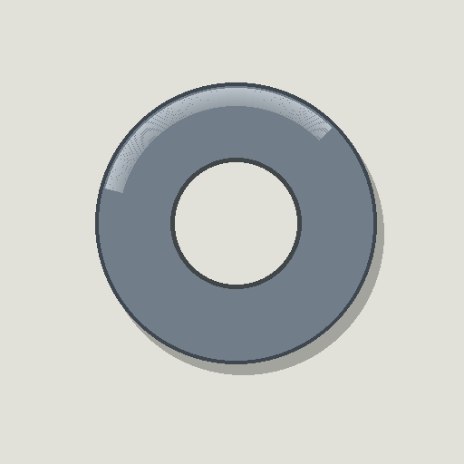
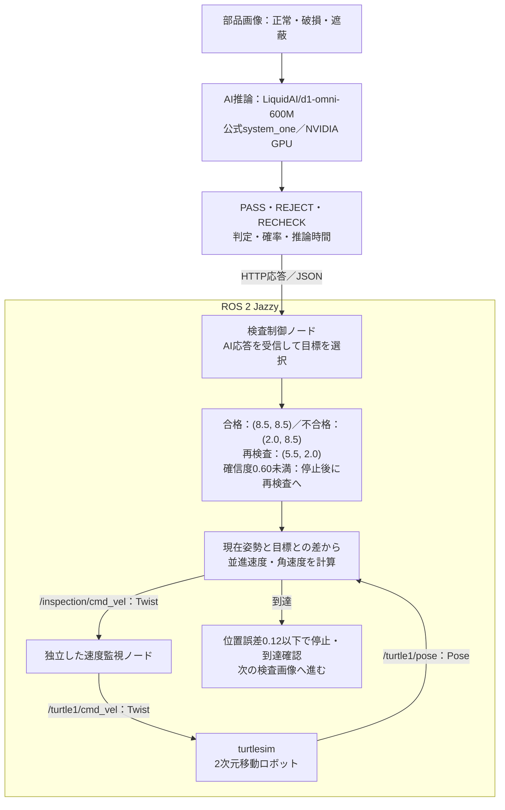

# 画像検査AIとROS 2による自律仕分けの検証

Physical AI応用1 最終課題 ／ 実測日：2026年10月22日

## 1．概要と目的

部品画像をAIで検査し、その判定結果に対応する場所へロボットを自律移動させる仮想仕分けを実装した。画像の認識結果をROS 2の速度指令へつなぎ、姿勢フィードバックによって目標への到達を確認することを目的とする。ロボットにはROS 2 Jazzyのturtlesimを使用し、2次元平面上の移動で仕分けを表現する。

## 2．画像に基づくAI判定

正常・破損・遮蔽の人工ワッシャー画像9枚を、LiquidAI/d1-omni-600Mの公式system_one APIへ入力した。画像と3択の判定文を与え、PASS（正常）、REJECT（破損）、RECHECK（遮蔽）の判定と各選択肢の確率を取得する。推論はNVIDIA GeForce RTX 3070上で実行した。正解ラベルは評価専用であり、AIへの入力や移動先の選択には使用しない。

  

図1．AIに入力する画像の例。左から正常・破損・遮蔽。

## 3．AI判定からROS 2の移動指令への変換

ROS制御ノードは画像ファイル名をHTTP POST /inferで推論サービスへ渡し、JSON形式の判定・確率・推論時間を受け取る。通常はAIの判定を下表の目標座標へ変換する。最大確率が0.60未満の場合は1秒間停止し、再検査の目標へ移動する。

| AI判定 | 仮想仕分け先 | 目標座標 (x, y) |
| --- | --- | --- |
| PASS | 合格 | (8.5, 8.5) |
| REJECT | 不合格 | (2.0, 8.5) |
| RECHECK | 再検査 | (5.5, 2.0) |

制御ノードは/turtle1/poseから現在の位置と向きを読み取り、目標との差に応じて並進速度と角速度を計算する。geometry_msgs/Twistを/inspection/cmd_velへ送信し、独立した速度監視ノードを経由して/turtle1/cmd_velへ伝える。位置誤差が0.12以下になったら停止して到達を記録し、次の画像へ進む。

## 4．システム構成図

画像の判定結果を目標座標へ変換し、ROS 2の速度指令と姿勢フィードバックによって移動する。目標への到達後に次の画像を検査する。

図2．AI判定とROS 2による自律移動の構成。

## 工夫した点

AI推論とROSの移動制御を分け、判定の完了後に移動を開始する。移動時間を決め打ちせず、実際の位置に基づいて到達を確認してから次の検査へ進むため、複数画像を連続して処理できる。低確信度の判定は再検査へ振り分ける。

推論待ち中は停止する。姿勢更新が0.5秒以上途絶えた場合、不正な応答を受け取った場合、推論または移動が30秒を超えた場合は停止して処理を中止する。速度監視ノードも指令更新が0.5秒途絶えた場合や非数値の速度指令を検出した場合に停止させる。

## 5．AI判定と移動の実測結果

9枚を順番に検査し、判定に基づく3種類の目標へ全9件到達した。低確信度による一時停止と再検査への振り分けは2件だった。表の「AI判定」はモデルの最大確率の選択肢、「移動先」は低確信度処理も反映した振り分け先を示す。

| 検査番号 | 正解 | AI判定 | 移動先 | 確信度 | 推論ms |
| --- | --- | --- | --- | --- | --- |
| 01 | 合格 | 合格 | 合格 | 0.853 | 1903.9 |
| 02 | 不合格 | 不合格 | 不合格 | 0.737 | 223.4 |
| 03 | 再検査 | 合格 | 再検査 | 0.567 | 209.1 |
| 04 | 不合格 | 不合格 | 不合格 | 0.659 | 240.8 |
| 05 | 合格 | 合格 | 合格 | 0.650 | 238.8 |
| 06 | 再検査 | 合格 | 合格 | 0.647 | 281.0 |
| 07 | 合格 | 合格 | 合格 | 0.752 | 138.5 |
| 08 | 不合格 | 再検査 | 再検査 | 0.496 | 334.5 |
| 09 | 再検査 | 合格 | 合格 | 0.602 | 270.8 |

| 測定項目 | 実測値 |
| --- | --- |
| 選択された目標への到達 | 9/9件（目標座標は3種類） |
| 到達時の最大位置誤差 | 0.119925（許容値0.12） |
| GPU推論の平均時間 | 426.7ミリ秒 |
| AI判定の正解率／振り分け正解率 | 55.6%／66.7% |
